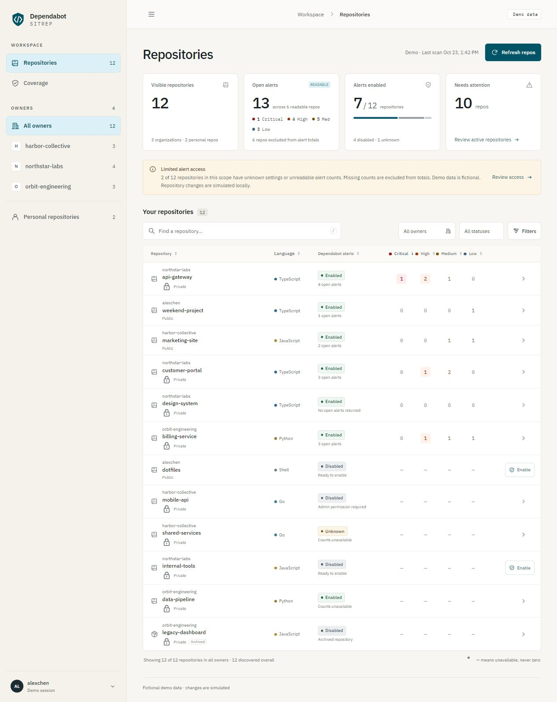

# Dependabot Sitrep

A Node.js dashboard for Dependabot alerts across your personal and organization repositories, using your own GitHub CLI login. Filter repositories, sort vulnerability counts by severity, inspect alerts, and find gaps in Dependabot coverage.



*Screenshot from demo mode. All accounts, organizations, repositories, and alerts shown are fictional.*

## Quick start

Install these tools and make sure they are available in your terminal:

- [Node.js 22 or newer](https://nodejs.org/) with npm.
- [Git](https://git-scm.com/downloads).
- [GitHub CLI (`gh`)](https://cli.github.com/).

Clone the project, sign in to **your own GitHub account**, and start the dashboard:

```sh
git clone https://github.com/dispatchlabs-ai/dependabot-sitrep.git
cd dependabot-sitrep
gh auth login --hostname github.com --web --scopes security_events
gh auth status --hostname github.com
npm start
```

Follow the browser sign-in prompts from `gh`. The `security_events` scope allows reading Dependabot alerts. If you already use `gh`, check the active account with `gh auth status --hostname github.com`; you can use that existing login and add missing permissions as described below.

Open **[http://127.0.0.1:4317](http://127.0.0.1:4317)**. The first repository scan starts automatically. Counts update as repositories are scanned; use **Refresh repos** for a new scan. Stop the server with **Ctrl+C**.

There are no npm dependencies to install and no build step. You do not need an `.env` file, a separate token, or a GitHub App installation. The dashboard uses the active `gh` account on the computer running the server.

## Try the demo

After cloning the project and entering its directory, run:

```sh
npm run demo
```

Demo mode needs Node.js only and uses fictional sample data. No GitHub login is required, and demo actions never modify GitHub. Open **[http://127.0.0.1:4317](http://127.0.0.1:4317)**. If the real dashboard is already running, use `npm run demo -- --port 4318` and open **[http://127.0.0.1:4318](http://127.0.0.1:4318)** instead.

## Accounts, hosts, and ports

Wait for any current scan to finish before switching accounts. To use another account already signed in through `gh`:

```sh
gh auth switch --hostname github.com --user YOUR_USERNAME
```

Replace `YOUR_USERNAME` with your GitHub username, then click **Refresh repos**. The next scan uses that account and clears the previous account's snapshot.

To use GitHub Enterprise Server, replace `github.example.com` with your GitHub hostname:

```sh
gh auth login --hostname github.example.com --web --scopes security_events
npm start -- --hostname github.example.com
```

To choose another local port:

```sh
npm start -- --port 4318
```

`GH_HOST` and `PORT` can also set the GitHub hostname and local port. The app listens only on `127.0.0.1` and is intended for one user on their own machine.

## What the dashboard measures

- **Repository access:** all pages of GitHub's authenticated-user repository endpoint, including personal repositories, direct collaborations, and organization/team access.
- **Alerts enabled:** GitHub's explicit GraphQL `hasVulnerabilityAlertsEnabled` field. An API failure is shown as unknown, never assumed disabled.
- **Open alerts:** all pages of each readable repository's open Dependabot alerts, grouped by severity. Only a successful read can produce a zero count.
- **Coverage:** enabled repositories out of the stated set of repositories. Archived repositories remain separately identifiable.

Repository visibility depends on the **active gh account and its credentials**, including organization SSO authorization and token restrictions. The dashboard cannot discover access hidden from those credentials. Counts remain partial while scanning or when alert access is unavailable. A new scan uses the active account again; switching accounts clears the previous account's snapshot.

The scan uses batched metadata reads and sequential alert requests. Results and progress stay in memory until the server stops. Refresh explicitly to scan again. Rate limits pause the scan and show when another attempt is allowed.

## Enabling alerts

The per-repository **Enable alerts** action requires administrator access and an explicit confirmation naming the repository. The server rechecks identity and repository permissions before sending the request, then verifies the resulting setting.

GitHub's enable endpoint turns on **Dependabot alerts and the dependency graph**. It does not configure Dependabot version updates or security-update pull requests. Organization policies or token permissions can still prevent the action even when the account is a repository administrator.

Demo mode simulates the change and never modifies GitHub. Scans never change repository settings.

## Permissions and troubleshooting

`gh` keeps authentication credentials; the browser never receives a GitHub token. The app invokes fixed `gh api` operations without a shell. It does not install a GitHub App or ask for a separate token.

If authentication fails, run `gh auth status --hostname github.com` to check the active account, then `gh auth login --hostname github.com --web --scopes security_events` to sign in again. If an existing classic/OAuth login lacks alert access, add the scope with:

```sh
gh auth refresh --hostname github.com --scopes security_events
```

Private repository discovery needs appropriate repository access. Organization SSO may require authorizing the credentials for that organization. Fine-grained personal access tokens can be limited to a single resource owner and selected repositories, and need **Dependabot alerts: read** permission to read alerts. Alert access and repository access are separate permissions, so a repository may appear while its alert counts remain unavailable. Unavailable counts are not zero vulnerabilities. See GitHub's [Dependabot alert permissions](https://docs.github.com/en/rest/dependabot/alerts#list-dependabot-alerts-for-a-repository).

If the dashboard uses an unexpected identity, check whether your terminal sets `GH_TOKEN` or `GITHUB_TOKEN`: these override the stored login for GitHub.com. Enterprise Server uses `GH_ENTERPRISE_TOKEN` or `GITHUB_ENTERPRISE_TOKEN`. After changing these environment variables, restart the server from the updated terminal. See the [GitHub CLI environment reference](https://cli.github.com/manual/gh_help_environment).

If port 4317 is already in use, choose another port using the command above and open the matching address.

The local server checks the request host and origin and requires a process-specific request token for actions. Do not expose it through a public tunnel or reverse proxy. No repository or alert data is persisted by the app.

## Design and development

The initial mockup was commissioned through OpenDesign using Local Codex. The application preserves its local developer-tool direction and adds real GitHub CLI integration. `npm run demo` provides a repeatable sample-data preview.

The backend uses Node's built-in HTTP server, child processes, and test runner. Tests inject a fake GitHub client/CLI runner; they do not change repository settings.

```sh
npm test
npm run dev
```

References: [repository access API](https://docs.github.com/en/rest/repos/repos#list-repositories-for-the-authenticated-user), [GraphQL repository fields](https://docs.github.com/en/graphql/reference/repos), [Dependabot alerts API](https://docs.github.com/en/rest/dependabot/alerts), [enable alerts API](https://docs.github.com/en/rest/repos/repos#enable-vulnerability-alerts), and [GitHub CLI API pagination](https://cli.github.com/manual/gh_api).
